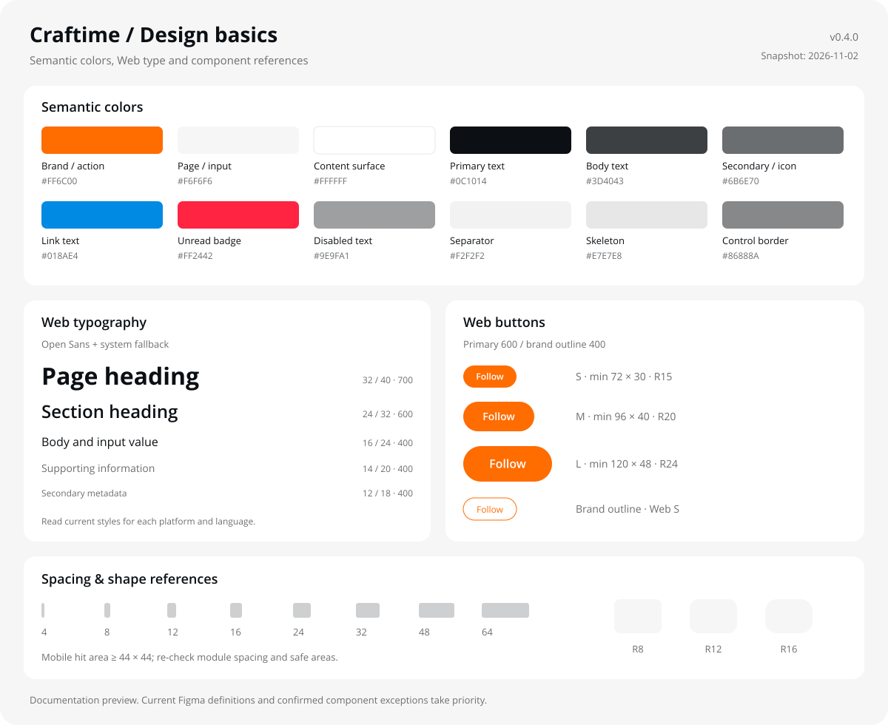

#  Craftime Design

**用于 AI 设计工作流的 Craftime 规范技能集。**

将设计规则、Figma 来源和检查方法整合为可复用的 Agent Skills，用于页面设计、样式优化、设计评审和定稿同步。当前版本 **v0.4.2**。

[快速安装](docs/INSTALL.md) · [工具兼容](docs/COMPATIBILITY.md) · [通用入口](CRAFTIME.md) · [更新记录](CHANGELOG.md)

## 快速开始

1. 下载本仓库，将 `skills/` 中的五个完整技能目录放入所用 Agent 的项目技能目录，具体位置见 [安装指南](docs/INSTALL.md)。
2. 在 Agent 中打开项目，重新加载技能或开始新会话。
3. 描述需求，附上目标页面链接或截图：

```text
使用 Craftime Design，优化这个页面：[Figma 链接或截图]。
平台：Web。交付：一屏效果。
按 Craftime 规范处理，保留未要求修改的布局、文案和交互。
```

需要直接读取或编辑 Figma 时，连接当前 Agent 的 Figma 工具，并确认账号与文件权限。未自动发现技能时，可让 Agent 先读取 [CRAFTIME.md](CRAFTIME.md)。

## 支持的工具

支持 `SKILL.md` 的 Agent 可使用同一套技能，按对应项目目录安装：

| 工具 | 技能目录 |
| --- | --- |
| Claude Code | `.claude/skills/` |
| WorkBuddy / CodeBuddy | `.codebuddy/skills/` |
| Codex | `.agents/skills/` |
| Cursor | `.cursor/skills/` |
| Gemini CLI | `.gemini/skills/` |
| GitHub Copilot | `.github/skills/` |
| OpenCode | `.opencode/skills/` |

Claude 桌面版、Cowork及其他云端产品使用各自的技能/插件导入入口，详见 [兼容说明](docs/COMPATIBILITY.md)。DeepSeek作为模型使用时，安装方式取决于承载它的工具；例如在WorkBuddy中使用DeepSeek，仍按WorkBuddy的目录安装。

## 主要能力

| 能力 | 作用 |
| --- | --- |
| 页面设计 | 根据相关规范选择文字、颜色和组件，组织页面内容 |
| 样式优化 | 改善主次、留白、信息密度和图标辨识，保留未要求修改的内容 |
| 设计评审 | 核对属性、引用与截图，区分规范偏差、建议和待验证项 |
| 移动端设计 | 先读同模块移动稿与移动端规范，再安排窄屏布局和触屏操作 |
| 定稿同步 | 按最新稿和实际交付范围，同步一屏、流程或全部状态 |
| 规范查询 | 查看采用记录、读取来源和检查证据，维护规范索引 |

## 设计规范速览

浅色界面以内容与手工作品为视觉重心；通过文字层级、间距和白色表面组织信息，品牌橙用于识别与主要操作。



> 这是基于已确认规则与项目规范文档整理的 **2026-11-02 样式快照**，不是实时 Figma 截图或已绑定变量的组件。示例字体按浏览器可用字体渲染；实际任务仍需读取对应平台、语言和组件的最新定义。用户最新要求及有来源的组件特例优先，历史稿不批量迁移。

### 颜色：先选用途，再选色值

| 用途 | 色值 | 使用要点 |
| --- | --- | --- |
| 品牌、主要操作 | `#FF6C00` | 主操作与品牌识别；不把所有次要操作都做成橙色 |
| 页面、输入/搜索默认底色 | `#F6F6F6` | 色值共用，`surface/page`、`field/background`等语义仍分别保留 |
| 内容表面 | `#FFFFFF` | 白色内容区；取消独立分组浅底，以间距和标题组织 |
| 主要文字 / 正文 | `#0C1014` / `#3D4043` | 按文字用途区分 |
| 辅助文字、常规图标 | `#6B6E70` | 有效辅助信息；不使用禁用灰代替 |
| 禁用文字 | `#9E9FA1` | 仅用于真正禁用状态 |
| 链接文字 | `#018AE4` | Web/App/H5共用已确认链接蓝；保留地址和原有状态，不虚构正式变量已发布 |
| 普通内容分隔线 | `#F2F2F2` | 100%不透明，默认1px；与描边分开选择 |
| 装饰描边 / 控件描边 | `#CECFD0` / `#86888A` | 不能挪作普通内容分隔色 |
| 骨架内容占位、既有禁用表面 | `#E7E7E8` | 骨架只替换主要内容占位，不铺满整个模块 |
| 通知未读点与数量徽标 | `#FF2442` | 数字徽标红底白字；不替换成品牌橙 |

基础中性色是全产品色阶，服务于文字、图标、描边、表面与骨架；不能整套归为文字色。这里列出的色值不证明已建立或发布了对应 Figma 变量，绑定与别名仍需实读。详细规则见 [颜色语义](skills/craftime-figma-ui/references/color-semantics.md)。

### 字体与层级

**Web英文与数字优先 Open Sans，中文使用设备系统中文字体。** Figma使用具体字体并保留原生可编辑文字，不能模拟浏览器回退。Mobile按其平台定义读取，不自动沿用Web字族。

下面是文档中记录的 **Web英文角色参考**，单位为px；实际采用前核对实时样式：

| 角色 | 字号 / 行高 | 字重 |
| --- | --- | --- |
| 页面标题 | 32 / 40 | 700 |
| 分区标题 | 24 / 32 | 600 |
| 弹窗标题 | 18 / 24 | 600 |
| 正文、输入值 | 16 / 24 | 400 |
| 连续阅读正文 | 16 / 26 | 400 |
| 单行辅助信息 | 14 / 20 | 400 |
| 次级元信息 | 12 / 18 | 400 |
| 导航、分类、Tab、筛选、字段名、按钮、行内操作 | 保持对应组件字号 / 行高 | **600** |
| 未读数、徽标、关键计数 | 保持已确认字号 / 行高 | **600** |

**功能文字先按用途选样式，未选中或灰色状态也保持600。** 昵称、正文、评论及内容小标签默认400；内容小标签不包括可点击筛选和Tab。时间、输入内容及辅助说明可用400；不用Light300，不自动覆盖用户已有加粗或历史稿。实际检查读取fontWeight和可变轴wght，不能只看字体菜单写Regular。功能文字400/500会报告偏差，缺用途证据为待验证。详细规则见 [Web字重按用途选择](skills/craftime-figma-ui/references/typography-roles.md)。

页面标题规格不机械套给所有局部标题；不靠缩字号、压行高解决内容溢出。中文、Mobile及历史组件的角色与迁移范围分别核对。字体流程见 [设计工作流](skills/craftime-figma-ui/SKILL.md) 和 [原生文字写回](skills/craftime-figma-ui/references/font-writeback.md)。

### 按钮与控件

| 尺寸 | 视觉高度 | 最小宽度 | 左右内边距 | 文字字号 / 行高 | Web圆角 |
| --- | --- | --- | --- | --- | --- |
| S | 30 | 72 | 16 | 12 / 18 | 15 |
| M | 40 | 96 | 20 | 14 / 20 | 20 |
| L | 48 | 120 | 24 | 16 / 20 | 24 |

这张表是规范文档记录的尺寸参考，部分参数在原尺寸页仍有建议标记；按实际组件与场景使用，不覆盖既有业务特例。新Web功能按钮默认600，包括Primary和Outline；Primary为品牌橙底白字，品牌Outline为橙色描边与文字。已确认的Meetup小号Cancel/Recap保留Regular特例，Mobile及历史组件不批量迁移。**Outline不是所有“次要按钮”的通用映射**，已有中性次操作保持对应定义。

- 单行输入/选择框常规高48、圆角12；不将其高度直接套给多行文本域。
- 移动端视觉尺寸与外层点击区域分开处理，触控热区至少44×44且不重叠。
- Status筛选无填充；默认/展开描边 `#CECFD0`，Hover为 `#B6B7B8`，不添加Hover灰底。普通菜单Hover仍沿用已确认浅灰。
- 不补回已取消的Pressed状态；具体业务状态按用户确认范围。
- 预览展示既有品牌规格，不能据此宣称完成可访问性验收；品牌橙配小号白字的对比度仍有待确认项。

### 间距、形状与移动端

| 项目 | 文档参考 |
| --- | --- |
| 基础间距 | 4 / 8 / 12 / 16 / 24 / 32 / 48 / 64 |
| 同组内容 | 8 / 12 / 16 |
| 内容分组 | 16 / 24 / 32 |
| 页面分区 | 32 / 48 / 64 |
| 常见圆角 | 小型表面R8、控件R12、大型表面R16；胶囊按高度一半 |
| Mobile常规内容边距 | 左右16；通栏媒体和有来源的组件例外分别处理 |

按内容关系选档，组内间距小于组间间距，不强制把安全区、行高、图片比例等取整为间距档位。移动端先读同模块原稿与正式间距规范，再独立排布，安全区按实际设备处理。

### 图标与视觉检查

图标选自 [MingCute](https://www.mingcute.com/)，交付真实可编辑的原生Stroke与路径，**最终使用尺寸下描边1.67px**，绑定 `icon/stroke-width`。常见视觉尺寸为16 / 20 / 24；填充轮廓不等于可调描边。

还要比较图标的含义与轮廓，避免“想做、点赞、收藏”等动作混淆；检查实际尺寸截图、留白和主次。具体来源与要求见 [图标规则](skills/craftime-figma-ui/references/icons.md)，四项设计决策见 [设计与交付规则](skills/craftime-figma-ui/references/design-decisions.md)。

正式入口：[颜色](https://www.figma.com/design/03EUC7nSmTdbnEjMOWAQ3U?node-id=1991-4) · [字体](https://www.figma.com/design/03EUC7nSmTdbnEjMOWAQ3U?node-id=1991-296) · [尺寸与布局](https://www.figma.com/design/03EUC7nSmTdbnEjMOWAQ3U?node-id=1991-837) · [图标](https://www.figma.com/design/03EUC7nSmTdbnEjMOWAQ3U?node-id=2540-2)

## 技能入口

| 技能 | 用途 |
| --- | --- |
| [craftime-figma-ui](skills/craftime-figma-ui/SKILL.md) | 设计或优化页面 |
| [craftime-review](skills/craftime-review/SKILL.md) | 只读检查设计；按明确授权修复 |
| [craftime-setup](skills/craftime-setup/SKILL.md) | 检查技能与 Figma 接入 |
| [craftime-status](skills/craftime-status/SKILL.md) | 查询规范采用情况与执行证据 |
| [craftime-refresh](skills/craftime-refresh/SKILL.md) | 核对或维护规范索引 |

保留五个目录及其中的 `references`、`scripts` 等资源，确保相对引用完整。实际执行版本和检查结果以当前任务证据为准。

## 常用提示词

**检查设计稿：**

```text
使用 craftime-review，只读检查这个画板：[Figma 链接]。
列出已确认的偏差、建议和待验证项，先不要修改。
```

**制作移动端：**

```text
使用 craftime-figma-ui，制作这个模块的移动端页面：[需求与目标链接]。
先读取同模块移动稿和移动端间距规范，再独立安排布局。
```

## 规范来源

- [Craftime 组件规范](https://www.figma.com/design/03EUC7nSmTdbnEjMOWAQ3U?node-id=2173-505)：基础定义与组件来源。
- [Craftime UI](https://www.figma.com/design/h2Yu0Mg9J23KCatfp4uBgh/Craftime-UI?node-id=122-56)：在获准范围内查找业务参考。
- 固定导航、完整顶部及其他特例，采用技能中记录的精确来源和用户最新要求。

本地规则与索引用于指导工作，实时样式仍需按任务读取。Skill提供规则，Figma工具提供实际读写能力；安装技能不会自动授予文件权限。仅基于截图或本地材料完成的工作，应按实际范围说明结果。

## 进阶接入

通常使用Skill即可。需要Codex规范面板、Claude Code插件、Gemini扩展或本地MCP检查时，按 [兼容说明](docs/COMPATIBILITY.md) 配置。

纯规则阅读无需先配置面板或本包MCP；运行附带检查脚本或本地服务需要Node.js 22+，无需npm install。面板与写入能力取决于当前宿主及权限。

## 开发与维护

```sh
node scripts/build-panel.mjs
node --test tests/*.test.mjs
node tests/mcp-integration.mjs
```

v0.4.2已通过67项测试与9项本地stdio MCP集成检查，包含按文字用途检查真实字重。各客户端实际加载、安装和实时Figma操作尚未逐一验收。GitHub源码更新与账号插件发布分别维护。

[第三方许可](assets/THIRD-PARTY-NOTICES.md) · 本仓库未新增开源许可证。
